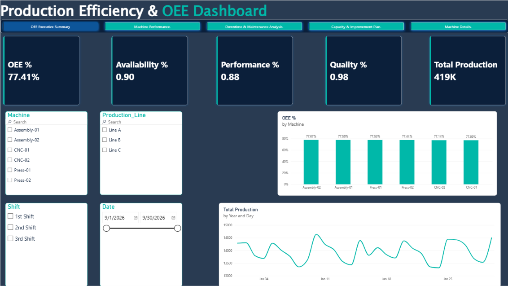

# Production OEE Improvement Dashboard

## Overview

This project analyzes manufacturing machine performance using Power BI and Overall Equipment Effectiveness (OEE).

## Objectives

- Measure machine OEE
- Analyze availability, performance, and quality
- Identify downtime causes
- Compare machine performance
- Recommend improvement priorities

## Key Metrics

- OEE %
- Availability %
- Performance %
- Quality %
- Total Production
- Total Downtime
- Defect Rate
- Production Cost

## Tools Used

- Microsoft Power BI
- Power Query
- DAX
- Excel/CSV
- Six Sigma concepts

## Dashboard Pages

1. OEE Executive Summary
2. Machine Performance
3. Downtime & Maintenance Analysis
4. Capacity & Improvement Plan
5. Machine Details

## Dataset

The dataset is synthetic and contains 180 machine-performance records.

## Project Outcome

The dashboard helps identify machines with low OEE, high downtime, and high defect rates so improvement actions can be prioritized.

## Dashboard Preview

